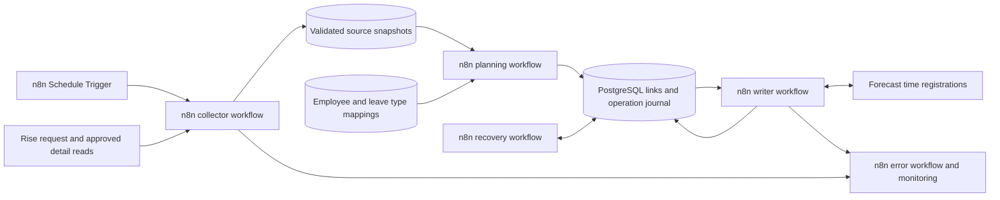

# Rise HR to Forecast time off integration design

Draft for review · 26 October 2026

Rise owns leave requests and approval decisions. Implement the integration in the existing n8n environment, using configured workflows to reconcile each approved request into dated Forecast time registrations, retain the relationship between those records, and correct Forecast when Rise changes. The business outcome is that approved leave contributes the intended minutes to the employee's Forecast timesheet.

The architecture is feasible, but production implementation depends on confirming how Rise exposes the exact daily quantities and leave policy for an already approved request. Its documented request list does not provide those details. Forecast's treatment of the resulting registrations must also be demonstrated in your tenant before considering the business outcome proven.

## Scope and proposed defaults

The first release synchronizes from Rise to Forecast. It reads Rise and creates, updates, or deletes only the Forecast records it owns. Employees continue requesting and approving leave in Rise.

| Choice | Proposed default |
| --- | --- |
| Integration platform | Confirmed: use the existing n8n environment |
| Implementation method | Configure n8n workflows and HTTP Request nodes; use small JavaScript Code steps for normalization and reconciliation, plus SQL for durable state |
| State storage | Proposed: a dedicated PostgreSQL application schema accessible from n8n; database availability remains to be confirmed |
| Approval authority | The current Rise request status, with `confirmed` treated as approved |
| Destination | One Forecast time registration for each request component and leave date with positive minutes |
| Leave types | Confirmed business rule: keep Vacation and Personal Day as separate Forecast categories; explicitly allow other types |
| Frequency | Poll every 15 minutes, configurable after measuring API volume and business needs |
| Change detection | Confirmed: polling and snapshot comparison; no Rise time-off delta or event mechanism is available |
| Rise token endpoint | Confirmed: `https://api.risepeople.com/oauth/token` |
| Employee directory | Rise People API `GET /v1/employees` with `employees:read`; verify service-user visibility |
| Initial request pacing | Proposed operational assumption: 30 requests per minute per provider, burst size one, shared across this integration's workflows; tune from observed behavior |
| Edited request awaiting approval | Confirmed business rule: remove linked Forecast time until the edited request is approved |
| Initial import | Dry run over a configurable period; agree the first managed date before enabling writes |
| Historical corrections | Reconcile all previously managed requests; route blocked or locked-period changes to an operator |
| Manual Forecast time | Preserve it and flag potential duplicates or conflicts |

Forecast timesheet approval is a separate workflow from Rise leave approval. Do not assume a Rise approval can set Forecast's timesheet approval state.

## API findings that affect the design

### Forecast records

`non_project_time` defines categories, including `is_internal_time`. Use approved category IDs configured as time off (`false`), rather than creating a category for each request. Employee/date/minute entries use the Time Registrations API. Its documented writes are `POST /api/v1/time_registrations`, `PUT /api/v1/time_registrations/{id}`, and `DELETE /api/v1/time_registrations/{id}`. Reads include a single record under v3 and paginated collection reads under v4. [Categories](https://github.com/Forecast-it/API/blob/master/sections/non_project_time.md), [time registrations](https://github.com/Forecast-it/API/blob/master/sections/time_registrations.md).

The documented registration update fields omit the person and category. Replace a registration when either changes; update minutes in place when supported. Forecast also exposes allocations against non-project categories. Keep allocations outside the initial scope unless tenant testing establishes that they are needed for the intended timesheet behavior or the business adds capacity planning. [Time registrations](https://github.com/Forecast-it/API/blob/master/sections/time_registrations.md), [allocations](https://github.com/Forecast-it/API/blob/master/sections/allocations.md).

### Rise visibility and completeness

The current Time Off specification supports OAuth client credentials with `time_off:read`. Machine tokens must specify an employee for `GET /v1/time_off_requests`. The list supports status and overlapping date filters, page numbers, and page sizes up to 100. It documents neither a modification cursor nor request-detail lookup by ID. [Rise Time Off reference](https://developer.risepeople.com/reference/time-off/), [downloaded specification](api/rise-time-off.openapi.yaml).

The list returns IDs, status, and date boundaries. Detailed components with daily `balance_impact` are documented through the pending-review queue's includes. That queue cannot be relied upon to retrieve approved requests or capture requests approved between polls.

The calendar endpoint provides confirmed absences with IDs matching request IDs, policy names, units, and boundary increments. However, visibility follows the service user's permissions, and the response does not expose every daily override or a stable enrollment ID. The impact preview computes daily costs using current rules; it does not establish the quantities actually approved. These limitations prevent claiming complete synchronization of arbitrary approved requests from the documented endpoints alone. [Rise Time Off reference](https://developer.risepeople.com/reference/time-off/), [component and calendar schemas](api/rise-time-off.openapi.yaml).

### Authentication

Use `https://api.risepeople.com/oauth/token`, confirmed by the integration owner. Rise's authentication specification defines a body-based client-credentials exchange and a returned expiry. Cache the access token until shortly before that expiry, then obtain a new token. Configure the confirmed URL explicitly rather than inheriting the conflicting `/v1/oauth/token` value in the Time Off and People reference security schemes. Request `time_off:read` and `employees:read` for the integration's read operations, subject to the application's grants. The service user's visibility must cover every employee in scope; scopes alone do not prove organization-wide access. A credentialed connection test remains part of implementation validation. [Rise authentication](https://developer.risepeople.com/reference/auth/), [authentication snapshot](api/rise-auth.openapi.yaml), [People reference](https://developer.risepeople.com/reference/people/).

Forecast uses `X-FORECAST-API-KEY`; its documentation says the key provides full account access. Store it through n8n's credential mechanism or the organization's connected secret manager, use a dedicated integration key, and restrict the worker's write behavior to recorded destination IDs. Follow each API's own pagination conventions. [Forecast API conventions](https://github.com/Forecast-it/API/blob/master/README.md).

## n8n integration architecture



The implementation method is an n8n integration with limited embedded code. Scheduling, HTTP calls, branching, and operational handling live in workflows; JavaScript steps perform deterministic data transformation and comparison. A separate custom application service or custom n8n node is not required by this design.

Use the HTTP Request node for Rise and Forecast so the workflow can implement the exact verified API routes and pagination. The node supports JSON bodies, pagination, and response headers/status. Keep separate request configurations for each API rather than sharing page parameter names. [n8n HTTP Request](https://docs.n8n.io/integrations/builtin/core-nodes/n8n-nodes-base.httprequest/).

### Workflow responsibilities

| Workflow | Trigger and responsibilities |
| --- | --- |
| Collect Rise requests | Schedule Trigger every 15 minutes; acquire collection ownership, refresh the People roster when due, load employee mappings, authenticate, retrieve every request page, validate completeness, and persist the observed snapshot |
| Plan request changes | Invoke after a valid collection; normalize approved quantities, apply lifecycle rules, compare desired entries with linked entries, and journal the required operations without calling Forecast |
| Apply Forecast changes | Invoke after planning and when due operations need processing; claim one request, verify its current desired version and destination state, execute ordered operations, and save each result |
| Recover and reconcile | Scheduled sweep and controlled manual request replay; inspect abandoned work, ambiguous writes, and stale sync state, refresh Rise observations, and resume only operations proven safe |
| Handle execution errors | Error Trigger workflow; record sanitized execution references, surface unexpected failures, and notify the configured internal operations destination |

Implement shared logic as sub-workflows where useful. Configure the collector's workflow timezone explicitly as `America/Toronto`; leave dates still follow each employee's applicable local calendar. Publish the scheduled workflows as part of deployment. [n8n Schedule Trigger](https://docs.n8n.io/integrations/builtin/core-nodes/n8n-nodes-base.scheduletrigger/).

The planner must distinguish status completeness from approved-detail completeness. A verified pending amendment can produce deletion operations even when its new daily quantities are unavailable. A confirmed request cannot produce create operations until its approved detail is complete.

### Durable state and concurrency

Use a dedicated PostgreSQL schema for employee/category mappings, snapshots, entry links, operations, collection ownership, and request ownership. This may use an existing approved PostgreSQL service; do not read or write n8n's internal application tables. Database access, backups, retention, and schema provisioning remain deployment dependencies.

Use parameterized Postgres queries and database functions for atomic ownership claims and state transitions. The Postgres node supports query parameters and transaction batching. Keep each database transaction inside one query/function or one supported transaction batch; do not assume transactions span separate n8n nodes or HTTP calls. [n8n Postgres node](https://docs.n8n.io/integrations/builtin/app-nodes/n8n-nodes-base.postgres/).

Persist the intended operations before calling Forecast. Enforce logical-key uniqueness and one active writer per request in the database, including scheduled runs, manual runs, and sub-workflows. Process mutations sequentially for each request. Represent ownership with an owner ID, expiry, and operation version checked by atomic updates. An expired owner with an in-flight operation goes to recovery; do not immediately assign another writer while the original API request might still complete. Workflow concurrency settings alone are not the ownership mechanism.

Use PostgreSQL as the authoritative ledger. n8n Data Tables are available for persistent lookup data, but this design does not rely on them for the required atomic claims and uniqueness guarantees without further validation. Avoid workflow static data for the ledger: n8n documents that its changes are saved on successful execution and notes reliability limitations. [Data Tables](https://docs.n8n.io/data/data-tables/), [workflow static data](https://docs.n8n.io/code/cookbook/builtin/get-workflow-static-data/).

### Credentials and execution behavior

Keep Rise client credentials, the Forecast API key, and PostgreSQL credentials out of workflow JSON, Code steps, pinned examples, and the operation ledger. Validate the deployed n8n version's credential support against Rise's body-based client-credentials exchange. If its generic OAuth configuration cannot express the verified contract, resolve that credential integration before implementation rather than hardcode a secret in a token request. Cache short-lived access tokens only in an approved protected mechanism, or obtain one per collection when practical.

Configure HTTP Request nodes to expose response status and headers to explicit branches for authentication, rate limiting, validation, and transient failures. Disable blanket automatic retries on Forecast creates. Journal ambiguous timeouts before any retry decision. Use persisted attempt counts and `next_attempt_at` for delayed retries so recovery does not depend on a long-running workflow staying alive.

Handle expected per-request exceptions within the workflow and record them in PostgreSQL. Configure a shared Error Trigger workflow for unexpected execution failures; it does not replace business exception handling or the recovery sweep. n8n supports attaching an error workflow in workflow settings. [n8n error handling](https://docs.n8n.io/flow-logic/error-handling/).

Operator replay must enter through the recovery workflow, load current database state, and refresh Rise. Do not blindly retry a failed execution with its old input when it might repeat a completed Forecast write. Keep a database-backed writes-enabled flag checked before each mutation, with a separate dry-run mode that records proposed changes and makes no Forecast mutations.

Limit retained n8n execution payloads and access because they can contain employee leave data and token responses. Retain sanitized operation outcomes in PostgreSQL for the agreed audit period. Validate execution-saving and credential-redaction behavior in the deployed n8n version before enabling production runs.

Rise time-off change detection is polling-only, as confirmed by the integration owner. Re-read request state and content and compare normalized snapshot hashes; the design does not depend on update timestamps, source revisions, change feeds, webhooks, or deletion markers. Hashes detect a changed observation but cannot reconstruct intermediate states between polls. If a request returns to pending approval and is approved again between observations, reconcile its latest observed state; the integration cannot guarantee that it reproduces the temporary absence of Forecast time during that interval.

## Source collection

Maintain an explicit roster of Rise employee IDs linked to Forecast person IDs. Populate it from `GET https://api.risepeople.com/v1/employees` using `employees:read`, `page[number]`, and `page[size]` up to 100; validate all pages against `meta.count`. Use the employee resource `id` as the Rise identity and `work_email`, where visible, to propose a reviewed Forecast match. Do not substitute `employee_code` or a payroll ID for the employee resource ID. Verify the join to Time Off's `employee_id` with representative records. [Rise People API](https://developer.risepeople.com/reference/people/), [People specification snapshot](api/rise-people.openapi.yaml).

Refresh the roster daily and through an operator-triggered refresh, caching reviewed mappings between runs. Discover without employment-stage filters initially; apply the agreed employee scope after collection so former employees with managed leave remain available for reconciliation. The People list excludes incomplete onboarding records and can return only the service user's record when directory/profile visibility is insufficient. Fields such as work email may be absent or null. Validate expected roster coverage before publishing a refreshed roster. If pre-onboarding staff are in scope, assess the separate onboarding operations rather than assuming the employee list includes them. [Rise People API](https://developer.risepeople.com/reference/people/).

A missing directory row, changed email, or employment-stage change must not delete an established mapping or managed leave automatically. Retain historical mappings and reconcile previously managed employees; missing or inaccessible identities become exceptions. Directory access and time-off/private-policy access require separate checks. Do not infer the entire employee population from visible calendar absences.

For each employee, read all pages of requests without a status filter. Initially prefer an unbounded request history scan, where tenant volume allows it, so a request moved outside a date window remains observable. Retrieve exact approved components through a vendor-confirmed supported read or report, and join them by request ID. Until that read exists, confirmed requests lacking daily detail become exceptions and cause no new Forecast writes.

If full scans become too expensive, use bounded discovery plus a periodic complete scan and an explicit strategy to re-read every managed request. A rolling date window alone cannot detect every moved or historical request. No historical correction is guaranteed beyond the source retention available to the integration.

Publish a snapshot only after every page succeeds, duplicate IDs are resolved, required data is present, and totals are consistent. Page-based collections can change during collection: repeat unstable scans, and require a fresh confirming observation before destructive reconciliation. Authentication, visibility, or empty-result anomalies suspend deletion. An absent row is an exception to investigate, not evidence of cancellation.

Fetch only the HR fields needed for identity, approval state, dates, quantities, and policy mapping. Avoid balances, compensation, comments, medical explanations, and approver notes unless a specific mapping requires them.

### Request pacing and scan capacity

Rise's applicable Time Off and People throughput limits are unconfirmed. Absence of a documented numeric limit is not evidence of unlimited capacity. Reference snapshots include rate-limit responses and an auth endpoint annotation, but these do not establish a safe shared budget for this tenant. The following values are proposed operating assumptions to validate during the dry run:

| Control | Initial setting |
| --- | --- |
| Rise pacing | At least two seconds between request starts, one in-flight request, no burst; includes People, Time Off, token requests, and recovery reads |
| Forecast pacing | Separate budget with the same initial pacing, including read and write recovery calls |
| Shared enforcement | PostgreSQL-backed provider budget and atomic slot claims used by every workflow, including manual runs; account for other integrations sharing vendor credentials |
| Rate-limit response | Honor `Retry-After` when present; otherwise cool down the affected provider for at least 60 seconds, doubling on repeated throttling up to one hour, with additional positive jitter |
| Recovery after throttling | Reduce the configured request rate and require a sustained successful period before increasing it; persist cooldowns across workflow restarts |
| Other transient failures | Bounded exponential backoff with jitter and at most five automatic attempts before an exception; ambiguous Forecast creates still require recovery before retry |

Implement pacing with a persisted due time and n8n waiting/scheduling between claims. Do not use a long blocking Code-node sleep. A provider cooldown gates its next outbound calls across workflows; avoid stacking ordinary retries on top of rate-limit retries.

A 15-minute trigger is a scheduling target, not a guaranteed synchronization delay. At the initial pacing, 450 request starts per provider is the theoretical 15-minute ceiling before response latency, retries, and processing time. Estimate the real budget from roster pages, each employee's request pages, approved-detail reads, verification reads, and Forecast writes. If a scan is still running at the next trigger, skip the overlapping start and record the lag. Measure actual time to converge during the dry run and adjust the polling interval or scan strategy without weakening completeness checks.

## Identity and leave mapping

| Mapping | Required fields and behavior |
| --- | --- |
| Employee | Organization, Rise employee ID, Forecast person ID, effective dates, enabled state, review metadata |
| Leave category | Rise stable policy ID where available, Forecast category ID, enabled state, effective dates |
| Duration rules | Source unit, approved hours-per-day basis where needed, rounding policy, effective dates |

Work email can suggest an initial employee match, but the reviewed stable ID mapping becomes authoritative. Reject ambiguous matches, duplicate destination matches, unknown policies, and inactive destination users. Names must not drive automatic matching. Forecast provides a persons collection with IDs and email. [Forecast persons](https://github.com/Forecast-it/API/blob/master/sections/persons.md).

Prefer stable policy IDs over names. If Rise can supply only a name for a restricted first release, require a reviewed mapping and treat renames, duplicate names, and withheld values as exceptions. Do not silently create or substitute a category.

## Daily quantity calculation

Normalize the approved source detail into this internal contract. This is the integration's proposed data shape, not a claimed Rise response:

```json
{
  "organization_id": "company",
  "request_id": "456",
  "employee_id": "12345",
  "status": "confirmed",
  "components": [
    {
      "component_id": "901",
      "policy_id": "vacation-policy",
      "days": [{"date": "2026-11-06", "minutes": 240}]
    }
  ]
}
```

Use approved minutes directly when available. For approved hours, multiply by 60 using decimal arithmetic. For approved day fractions, multiply by the verified hours represented by one day for that policy and date, then by 60. Rise's enrollment schema exposes `work_hours`, but historical changes and null values need an agreed fallback. Do not substitute Forecast's daily expectation automatically: a difference between systems is a business discrepancy to resolve.

For example, an approved half day is 240 minutes under an eight-hour basis and 225 under a seven-and-a-half-hour basis. A single-day calendar absence uses its start increment only; adding its end increment would overstate leave.

Preserve local leave dates as dates. Use the applicable employee calendar and approved per-date values, including partial days in the middle of a range. Do not distribute a total evenly across dates or assume Monday to Friday. Zero quantities produce no registration. Exclude time-worked accrual components. Reject unknown units, incomplete quantities, and unexplained negative values. Agree rounding to whole minutes and verify daily totals before writing.

Do not subtract project work or other manually entered time from approved leave automatically. Flag overlaps and total-day discrepancies for review while preserving the approved leave quantity.

## Request lifecycle

The following is proposed integration behavior. Rise's enum lists states but does not fully define cancellation and modification semantics; confirm those before enabling removal.

| Current observation | Existing managed Forecast time | Proposed action |
| --- | --- | --- |
| Confirmed with complete approved detail | None | Create the desired daily entries |
| Confirmed and unchanged | Present | No operation |
| Confirmed with changed dates, quantity, or category | Present | Reconcile to the newly approved daily entries |
| Initializing, in progress, or in review | None | Create nothing |
| Edited request returns to pending approval after an approved version | Present | Delete linked integration entries; keep Forecast time absent until the edited request is confirmed |
| Edited request is approved again | None | Create entries from the newly approved daily detail using the mapped leave category |
| Explicit rejection or cancellation of the effective approved request | Present | Delete only linked integration entries, after validating Rise's state semantics |
| Closed or suspended without established meaning | Any | Hold existing time and raise an exception |
| Unknown future state | Any | Hold existing time and raise an exception |
| Missing from a collection, unreadable, or incomplete | Any | Hold existing time and investigate |

Once an edit returns a request to pending approval, its desired Forecast entry set is empty. A complete, verified status observation is sufficient to plan removal of its linked entries; daily quantities for the pending edit are not required. Recreate time only after a fresh confirmed observation and complete approved daily detail. Retain the previous approved snapshot for audit, without using it to restore time automatically.

Distinguish rejection of an amendment from revocation of the original approval. A rejected amendment does not by itself authorize restoring the old Forecast entries. If Rise explicitly restores an effective approved version, reconcile that confirmed version; if its meaning is ambiguous, raise an exception. A cancelled request may remain in the ledger even after all its destination entries have been deleted.

## Destination operations and ownership

The proposed logical key is `(organization, request, component, local_date)`. Keep the destination ID in a durable ledger; several Rise requests on the same day remain separately traceable. If the approved source has no stable component ID, establish a supported deterministic identity rule before implementation.

An illustrative Forecast create request is:

```http
POST https://api.forecast.it/api/v1/time_registrations
Content-Type: application/json
X-FORECAST-API-KEY: <secret>
```

```json
{
  "person": 101,
  "non_project_time": 12,
  "time_registered": 240,
  "date": "2026-11-06",
  "notes": "Managed Rise leave; ref=opaque-operation-reference"
}
```

IDs are illustrative. An opaque note reference assists recovery without copying HR explanations. Verify that notes survive writes and are readable. The documented registration write fields do not include an approval-status input. [Forecast time registrations](https://github.com/Forecast-it/API/blob/master/sections/time_registrations.md).

Reconcile the desired set against the last successfully applied set. Create missing dates, update changed quantities, and remove dates no longer approved. Replace entries for category or employee changes. Journal each replacement as separate steps: verify the old record, remove it, then create the replacement. A failure after removal leaves a visible pending correction; retry from the journal. This avoids temporary duplicate leave but can temporarily omit leave. Do not present a multi-record update as atomic.

Before modifying a destination record, compare it with the last applied payload. If someone has edited it, stop that request and raise a conflict. Leave unrelated entries untouched. Existing manual leave for the same date should trigger a duplicate check during onboarding and normal collection; never adopt or delete it without an explicit reviewed migration.

## Persistence and recovery

| Record | Purpose |
| --- | --- |
| Source snapshot | Observed status and content hash, collection time, completeness, approved detail provenance |
| Approved snapshot | Last approved daily values retained for audit; pending amendments have no desired Forecast entries |
| Entry link | Logical key, destination ID, last applied payload/hash, mapping version |
| Operation journal | Stable operation ID, intended payload, state, attempts, result, timestamps |
| Exception | Request reference, reason, owner, retry eligibility, resolution |

Use database uniqueness on the logical key for active links, durable operation IDs, and per-request locks. Store tombstones after deletion so replays cannot recreate a cancelled request or restore time removed for a pending amendment from an older snapshot. A fresh confirmed observation may supersede a pending-amendment tombstone and produce new create operations. Without a source revision number, content hashes detect changes but do not order them; serialize collection and require a fresh source observation before recovering stale work.

Do not assume Forecast provides an idempotency key. A create timeout or worker crash may leave a successful write without a saved destination ID. Mark it ambiguous, search the appropriate person/date records for the exact opaque operation reference, and adopt only one verified match. If zero matches cannot be established reliably, or there are multiple matches, pause for resolution; do not blindly repeat POST. This prioritizes duplicate prevention over immediate recovery.

Retry reads and safe writes after transient failures with bounded exponential backoff and jitter; respect `Retry-After`. Refresh an expired Rise token once. Invalid mappings, permissions, validation errors, and locked periods become actionable exceptions. Treat a deletion returning not found as converged only after confirming the correct tenant and recorded destination ID. Every successful operation updates the ledger independently.

Measure collection freshness separately from successful synchronization. Track oldest pending change, ambiguous writes, exceptions, and differences between desired and applied daily totals. Alert an operator after repeated failures or an agreed freshness threshold; provide replay by request after resolution.

## Questions that must close before production

### Remaining API data questions

- **Approved detail:** Which supported Rise endpoint or report returns already approved requests with stable request/component/policy identifiers, exact daily quantities, units, and manual daily overrides, including historical requests?
- **Lifecycle:** What statuses and record changes represent cancellation, rejection, edits awaiting approval, `closed`, and `suspended`? Do edits preserve request IDs, and how does Rise distinguish a rejected amendment from a still-effective original approval?
- **Employee coverage:** With the People API selected, does the service user's `employees:read` access return the full intended roster and the fields needed for matching? Does its separate Time Off access expose requests and private policies for those same employees, including former employees with managed entries?
- **Duration basis:** Can Rise return the approved hours or minutes for each date, or the historical hours-per-day basis needed to convert day fractions? How are holidays, non-working days, and overrides represented after approval?
- **History coverage:** How much request history remains readable after cancellation or employee departure, and is there any retention boundary that prevents a complete reconciliation scan? Change detection is confirmed as polling-only; request pacing remains an operational assumption to validate rather than a documented vendor guarantee.
- **Forecast behavior:** Does a non-project time registration with the mapped time-off category satisfy daily timesheet expectations for full and partial days in this tenant? Are allocations also required, and how would the two interact with approval and reporting?
- **Forecast corrections:** Which permissions and time-entry settings constrain creating, updating, and deleting future or historical leave, particularly in submitted, approved, or locked periods? What response identifies a blocked correction?
- **Forecast recovery:** Is there supported create idempotency or an external-reference field? Otherwise, are notes preserved and readable on time-off entries, and can the API reliably retrieve all relevant records to resolve an ambiguous create without duplication?

### Deployment and business configuration

Confirm the deployed n8n version, access to a dedicated PostgreSQL schema, credential setup, operational notification destination, employee scope, import cutoff, historical conversion basis, rounding rules, and audit retention. These are implementation inputs rather than unresolved choices of integration platform. Vacation and Personal Day remain separate categories, and pending amendments remove existing linked Forecast time as already agreed.

A restricted pilot could use calendar events for verified single-day requests with visible policy and units. It would still need validated conversion rules and must exclude unsupported requests explicitly. Calendar reconstruction must not be presented as a complete substitute for approved daily detail.

## Acceptance and rollout

Start with API contract checks and a read-only dry run. Compare representative Rise requests with proposed Forecast entries and resolve all mapping and quantity exceptions before enabling a small employee cohort.

| Scenario | Expected result |
| --- | --- |
| Approved full or partial day | Correct employee, category, local date, and minutes appear once |
| Several dates spanning weekends or holidays | Only the approved positive daily quantities appear |
| Partial day in the middle of a request | Actual approved quantity is preserved |
| Approval and subsequent edits between polling cycles | Latest approved state converges without relying on review-queue capture |
| Quantity reduced, date moved, or range shortened | Previously managed time is corrected with no stale dates |
| Category or employee changed | Replacement completes or remains a clearly recorded pending correction |
| Approved request is edited and returns to pending approval | Linked Forecast entries are removed; previous approved values remain only in the audit history |
| Edited request is approved again | Newly approved daily entries are created once under the correct separate category |
| Vacation and Personal Day requests | Each uses its own mapped Forecast category |
| Cancellation or rejected amendment | No stale entries or automatic restoration of old time; outcome follows the verified effective-approval semantics |
| Repeated run or process restart | No extra registrations |
| Scheduled and manual n8n runs overlap | Database ownership allows only one writer per request |
| n8n stops after Forecast succeeds but before ledger update | Recovery resolves the ambiguous operation before another create |
| An operator requests replay of a failed run | Current source and ledger state determine the work; stale execution input cannot repeat completed writes |
| Writes are disabled or dry run is selected | No Forecast mutation occurs, including during recovery |
| Create succeeds but its response is lost | Recover the one matching entry or stop as ambiguous |
| Pagination fails, access changes, or a request disappears | No deletion based on the incomplete observation |
| People permissions shrink or a mapped employee disappears | Coverage anomaly is raised; historical mappings and managed leave are preserved |
| Provider throttles a collection or recovery call | Shared cooldown prevents other workflows from immediately sending more calls |
| A collection exceeds its 15-minute interval | Overlapping collection is skipped and freshness lag is visible |
| Manual leave or a manual edit to managed leave exists | Conflict is visible and unrelated time remains intact |
| Forecast rejects a historical correction | Exception remains open until the correction is resolved |
| Employee schedule or policy conversion differs | Discrepancy is visible rather than silently rescaled |

Expand the cohort after demonstrating these outcomes. Disabling the database writes-enabled flag stops new mutations; already in-flight calls may still complete and must be reconciled. Rollback disables the n8n writer and uses the journal to review or reverse only integration-owned changes; it does not broadly delete time by employee and date. Keep recovery and read-only monitoring available while writes are disabled.

## Source snapshots

The local Rise OpenAPI files were downloaded from the public developer portal on 26 October 2026. They are reference snapshots, not application configuration. The authentication, time-off, and people snapshots identify version 1.0.0. The integration owner confirmed the production token URL and absence of time-off change mechanisms; these decisions govern configuration where a reference snapshot differs. Numeric request pacing is an integration assumption pending operational validation. Forecast links point to its current `master` documentation; pin the reviewed revision when implementing the API sub-workflows. n8n capability references were checked against its public documentation; confirm their availability and configuration against the deployed version before building.
